  

  
   
  
  
  
   
  
  

I build cloud platforms where the pipeline is the security control: nothing reaches production unscanned, unsigned or untracked.

My work starts from a hard constraint: a 4 GB GPU, zero stored secrets, a cluster that must reject what it cannot verify. It ends as a system where Terraform defines the infrastructure, GitOps ships the change, and admission policy has the last word.

Currently: BS Cyber Security at FAST-NUCES Islamabad, founding President of the campus AWS Student Builders Community, and contributor to [floci](https://github.com/floci-io/floci), the open-source local AWS emulator. Previously: DevSecOps Officer at Google Developer Groups on Campus.

[Portfolio](https://saimzaib.tech) · [LinkedIn](https://linkedin.com/in/saimzaib) · [Email](mailto:saimzaib.official@gmail.com)

## What I bring

| Cloud & platform | DevSecOps | Community & leadership |
|---|---|---|
| AWS in Terraform: VPC, ALB + Auto Scaling, private RDS, Lambda, least-privilege IAM | CI gates that block CRITICAL CVEs with Trivy before an image is pushed | Founded the campus AWS Student Builders chapter with AWS approval |
| Kubernetes with Helm and Argo CD GitOps across dev, staging and prod | Keyless cosign signing, SBOMs, and Kyverno rejecting unsigned images at admission | Hands-on workshops that take members from guided labs to their own deployments |
| Prometheus and Grafana with SLO, GPU, cost and security alerting | GitHub OIDC to AWS IAM, so pipelines hold zero long-lived secrets | Mentoring on Docker, Kubernetes and pipeline automation |

## How I take a system to production

The same discipline goes into every milestone I ship:

1. **write down what "done" means** as an acceptance test before building;
2. **make the pipeline enforce it**: scan, sign, attest, then admit;
3. **try to break it**: chaos experiments, load tests and a threat model, then a postmortem for whatever broke.

## Open-source contributions

**[floci](https://github.com/floci-io/floci)** (open-source local AWS emulator): 2 merged

| Area | What was broken | PR |
|---|---|---|
| EventBridge | API destinations couldn't deliver to an endpoint whose certificate came from a private CA, because Floci's HTTPS clients trusted only the roots built into the binary. Added `FLOCI_TLS_EXTRA_CA_PATH` and assembled outbound trust in one place, so JWT authorizers and AppSync OIDC accept those CAs too | [#7850](https://github.com/floci-io/floci/pull/7850) |
| SNS | HTTPS subscriptions to a private-CA endpoint failed for the same reason; they now share the same trust | [#8063](https://github.com/floci-io/floci/pull/8063) |

For #7850 I traced the failure to the HTTP client, proposed a design on the issue, agreed the scope with the maintainers, and tested against a local HTTPS server with a throwaway CA.

## Palisade, by the numbers

**[Palisade](https://github.com/saimcyber/palisade)**: a secure, self-hosted LLM inference platform. vLLM on a 4 GB GPU in k3d Kubernetes, behind an OpenAI-compatible FastAPI gateway.

| Area | What I built | Result |
|---|---|---|
| Supply chain | GitHub Actions with a Trivy gate, keyless cosign signing and SBOM | CRITICAL CVEs cut from **3 → 0** |
| Identity | GitHub OIDC federated to AWS IAM | **Zero** stored secrets |
| Admission | Kyverno policies plus default-deny NetworkPolicy | Unsigned images **rejected** at the cluster door |
| Multi-tenancy | Redis-backed per-tenant rate limits, token budgets, audit log, prompt guard | Each tenant held to its own budget |
| Observability | Prometheus and Grafana | **4** dashboards, **7** alerts (SLO, GPU, cost, security) |
| Resilience | Chaos engineering and k6 load tests, load shedding | **5** bugs fixed, including a Kyverno bypass |
| Decisions | STRIDE threat model, SLO, runbook, blameless postmortem | **27** ADRs and a public devlog |

Shipped in six acceptance-tested milestones, Sep to Nov 2026.

## Selected projects

| Problem | System | Outcome |
|---|---|---|
| Teams want a private LLM but can't trust what runs in the cluster | **[Palisade](https://github.com/saimcyber/palisade)**: Helm + Argo CD GitOps, signed images, Kyverno admission, tenant budgets | A self-hosted inference platform with a verifiable supply chain |
| Images ship to production without anyone checking them | **[SecureKubeOps](https://github.com/saimcyber/SecureKubeOps)** + **[securekubeops-infra](https://github.com/saimcyber/securekubeops-infra)**: two-repo GitOps pipeline, non-root images, Trivy scanning, SHA tags promoted dev → staging → prod | Every deploy is scanned, traceable and reproducible |
| Clicking through the AWS console doesn't scale or audit | **[AWS-Learning-Journey](https://github.com/saimcyber/AWS-Learning-Journey)**: VPC with public/private subnets and NAT, ALB + ASG, private RDS, SNS → SQS fan-out, Lambda | Infrastructure that is reviewed, versioned and rebuilt from code |
| Juniors don't know what to learn next in cloud security | **[cloud-security-roadmap](https://github.com/saimcyber/cloud-security-roadmap)**: a 26-week, gate-driven path of hands-on labs | A clear route from fundamentals to DevSecOps work |
| A monolith can't isolate access per service | **AwareNet** (private): 10+ Python microservices in Docker behind a REST gateway with JWT and RBAC | Each service is independently deployed and access-controlled |
| An off-grid solar system fails silently | **[solarwatch](https://github.com/saimcyber/solarwatch)**: polls the inverter and sends an hourly heartbeat and alerts to WhatsApp | Problems surface on my phone, not when the lights go out |

## Focus areas

- **Software supply chain security**: scanning, signing, SBOMs and admission control.
- **Platform engineering on Kubernetes**: GitOps, policy-as-code and observability that pages on the right thing.
- **Cloud infrastructure as code**: AWS in Terraform with least-privilege IAM by default.
- **Open source in the cloud tooling I use**: fixing real bugs upstream, starting with floci.

  
  
  
  
  
  
  
  
  
  
  
  
  

Always happy to talk about Kubernetes security, CI/CD supply chains, or getting a student community shipping real cloud projects. Reach me on [LinkedIn](https://linkedin.com/in/saimzaib) or by [email](mailto:saimzaib.official@gmail.com).
