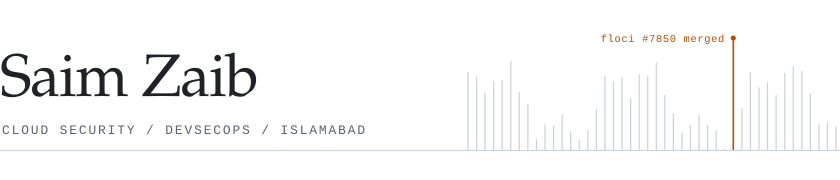
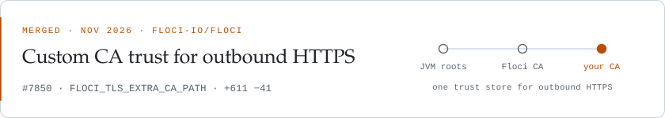

<picture>
  <source media="(prefers-color-scheme: dark)" srcset="assets/header-dark.svg">
  
</picture>

I work on cloud security and platform engineering: Kubernetes, GitOps delivery, and the supply chain that feeds them. I study Cyber Security at FAST-NUCES Islamabad, where I lead the AWS Student Builders Community.

## Open source

<a href="https://github.com/floci-io/floci/pull/7850">
  <picture>
    <source media="(prefers-color-scheme: dark)" srcset="assets/floci-dark.svg">
    
  </picture>
</a>

[Floci](https://github.com/floci-io/floci) is an open-source local AWS emulator. Its EventBridge API destinations could not deliver to an endpoint whose certificate came from a private CA. Floci's own HTTPS clients trusted only the roots built into the binary, so adding a CA to the host's trust store changed nothing.

I traced the failure to the HTTP client behind API destination delivery, proposed a design on [the issue](https://github.com/floci-io/floci/issues/5259), agreed the scope with the maintainers, and shipped it in [#7850](https://github.com/floci-io/floci/pull/7850).

- `FLOCI_TLS_EXTRA_CA_PATH` takes a PEM file of CA certificates and works with Floci's TLS on or off.
- Outbound trust is now assembled in one place: the JVM roots, Floci's own CA, and the extra CAs.
- The JWT issuer fetch uses the same trust, so HTTP API JWT authorizers and AppSync OIDC providers accept those CAs too.
- Tests run against a local HTTPS server with a throwaway CA. The setting is documented in the TLS and environment variable guides.

## Selected work

| | |
| :-- | :-- |
| [**palisade**](https://github.com/saimcyber/palisade) | Secure, self-hosted LLM inference. GitOps-delivered serving with a verified supply chain, per-tenant token budgets, and policy enforcement at admission. |
| [**SecureKubeOps**](https://github.com/saimcyber/SecureKubeOps) | A DevSecOps pipeline from commit to cluster: CI/CD, Docker, Kubernetes, with Prometheus and Grafana watching it. Manifests live in [securekubeops-infra](https://github.com/saimcyber/securekubeops-infra). |
| [**cloud-security-roadmap**](https://github.com/saimcyber/cloud-security-roadmap) | A 26-week, gate-driven path through cloud security and DevSecOps, built on hands-on labs. |
| [**AWS-Learning-Journey**](https://github.com/saimcyber/AWS-Learning-Journey) | Security-first AWS labs on the Free Tier, written in Terraform. |
| [**solarwatch**](https://github.com/saimcyber/solarwatch) | Watches a solar inverter and sends an hourly heartbeat and alerts to WhatsApp. |

<a href="https://saimzaib.tech">saimzaib.tech</a> &nbsp;·&nbsp; <a href="https://www.linkedin.com/in/saimzaib">LinkedIn</a>
